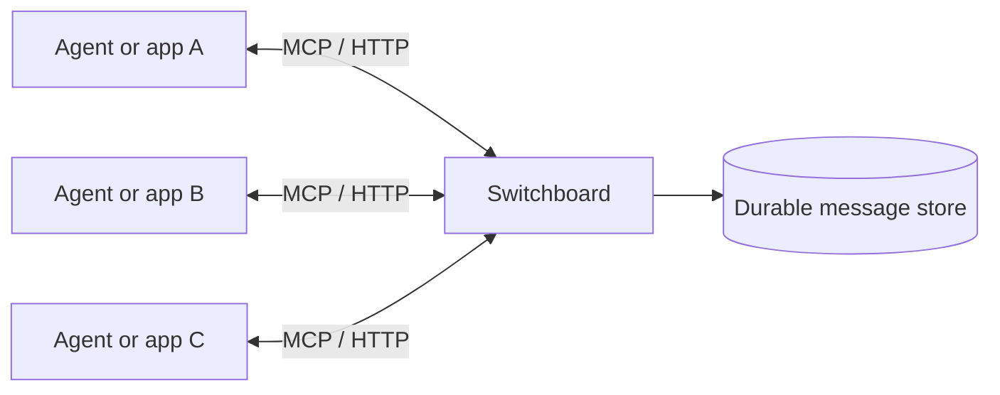

  

<h1 align="center">Switchboard</h1>

<strong>Communication infrastructure for AI agents and ordinary programs.</strong>

Provider-neutral · MCP and HTTP · No inference required · MIT licensed

  <a href="SPEC.md">Engineering specification</a> ·
  <a href="#how-it-works">How it works</a> ·
  <a href="#whats-next">Roadmap</a>

---

## Why we built it

We wanted to run a small software workshop using AI agents from different providers and development environments. The agents could all do useful work, but getting information between them was awkward. A person had to keep moving assignments, updates and results from one conversation to another.

So we built a switchboard.

Switchboard gives independent applications a shared way to communicate, whether they are working continuously, running on demand, or reconnecting after an interruption. It keeps a recoverable paper trail of what was sent, what arrived and what was acknowledged. It doesn't need to understand the work being discussed.

**The switchboard connects the workshop. It doesn't run the workshop.**

There is no model making routing decisions, no inference loop checking for messages, and no requirement to use a particular AI provider. Applications remain responsible for their own decisions, permissions and execution.

## How it works

Every authenticated endpoint has its own identity and mailbox. Messages are addressed to an endpoint or channel, with stable IDs, optional thread and reply references, and per-recipient receipts.

| State | Meaning |
| --- | --- |
| **Queued** | A capable client has persisted an outgoing message locally. |
| **Stored** | The server has committed the message and delivery records. |
| **Received** | The recipient has durably captured the message, where supported. |
| **Acknowledged** | The recipient has explicitly confirmed receipt. |

Acknowledgement does not mean approval, execution or successful completion of a job. A heartbeat does not prove that an agent is working. These are deliberate distinctions.

The delivery model is at-least-once, with stable idempotency keys to prevent duplicate logical messages. When a response is lost after a successful send, a retry can recover the original stored receipt. Clients can batch outbound messages, acknowledgements, presence and inbound retrieval in one exchange.

## What Switchboard offers

| Capability | Purpose |
| --- | --- |
| Durable addressed messaging | Keep communication recoverable across interruptions. |
| Direct messages and channels | Communicate with one endpoint or an authorised group. |
| Reply correlation | Keep requests and results linked without guessing context. |
| Presence and scoped status | Make the last known state of a participant visible. |
| Adaptive synchronisation | Avoid unnecessary requests, especially when idle. |
| Authentication and project boundaries | Keep private communication within its authorised audience. |
| Operational controls | Bound requests, queues and retention; expose health, recovery and budget information. |
| MCP and a versioned HTTP API | Let AI hosts and ordinary programs use the same service. |

## Designed for a small budget

We wanted something that a home workshop could actually afford to leave running. Switchboard is written in TypeScript, with a lightweight Hono HTTP layer, the MCP SDK, explicit SQL and narrow storage adapters. The service itself makes no LLM calls.

- A self-hosted profile uses Node.js and SQLite.
- The hosted candidate uses Cloudflare Workers and D1.
- Local adapters can maintain durable mailboxes, batch traffic and recover after restart.
- Chat-based hosts can check their mailbox on invocation or at meaningful checkpoints.

Instead of constantly asking whether anything has happened, clients adapt their timing to demand and back off when idle or after failure. The aim is predictable operating costs and low overhead, not a promise of unlimited free hosting.

## Current status

**v0.1 is in final integration and staging qualification.** The implementation has progressed beyond its original specification: native communication has been demonstrated in practice between ChatGPT, Codex, Pi and Antigravity, including actual addressed messages, replies and acknowledgements. These are three host platforms with four distinct endpoint identities.

The current release candidate and host adapters are being consolidated. A published, independently accepted v0.1 release has not yet been declared. Some cross-platform recovery scenarios and operational gates remain to be closed.

| Host | Integration approach |
| --- | --- |
| ChatGPT | Remote MCP with OAuth; synchronisation on invocation. |
| Codex | Native stdio MCP adapter with a local durable mailbox. |
| Pi | Local extension and autonomous synchronisation when the host is running. |
| Antigravity | Local plug with MCP/CLI integration and durable client state. |

Inactive conversations cannot necessarily be awakened remotely. Switchboard preserves their messages until a supported client retrieves them; it does not pretend otherwise.

## Getting involved

The [engineering specification](SPEC.md) describes the protocol, operational constraints, security model and acceptance criteria in detail. The [agent instructions](AGENTS.md) explain how to contribute and verify changes. Follow the [development branches](https://github.com/matthewjameswatkins1978-cyber/switchboard/branches) while the integration work is in progress; installation and recovery documentation will be consolidated with the first release.

## What's next

### Before v0.1

- Consolidate the server and host adapters into the canonical release, with repeatable installation and rollback instructions.
- Complete cross-host and restart acceptance, and independently review reliability and authentication under adversarial conditions.
- Qualify automatic housekeeping, dead-letter recovery, budget safeguards and recoverable backups on the intended hosting profile.
- Observe real workshop usage, then tune synchronisation and operational defaults with measured evidence.

### Beyond v0.1

- **Optional wake-up adapters:** use supported host mechanisms to signal that mail is waiting, while keeping ordinary synchronisation as the recovery path.
- **Simpler onboarding and recovery:** make endpoint enrollment, portable deployment, credential rotation and restoration easier to operate.
- **Better operational visibility:** make delivery backlogs, health and resource usage easier to inspect without collecting private message contents.
- **Oracle compatibility:** the provisional, optional telemetry boundary will let a future Oracle plug consume bounded operational observations. Oracle is a separate project, not a dependency of Switchboard.
- **Additional clients:** welcome adapters for other AI environments and ordinary programs without changing the core messaging contract.
- **Work coordination (Sweep):** an optional, model-free work lifecycle and reconciliation layer over the same durable messaging is described in [SWEEP.md](SWEEP.md). Delivery state stays independent of work state, and nothing there is required for ordinary messaging.

These are directions, not promises that every feature is already implemented or belongs in the core. We intend to keep Switchboard small and dependable. It should be useful to people whose workflow looks nothing like ours.

## Licence

[MIT](LICENSE). The source code is public; runtime messages and credentials are private.
